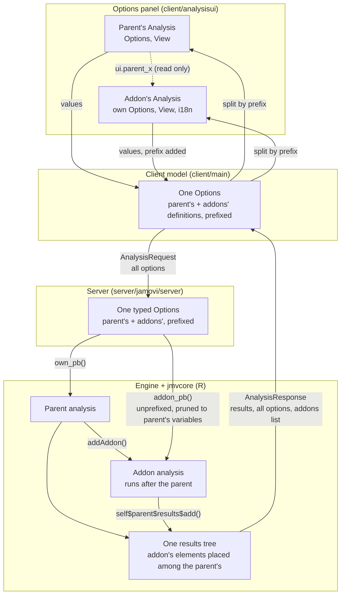
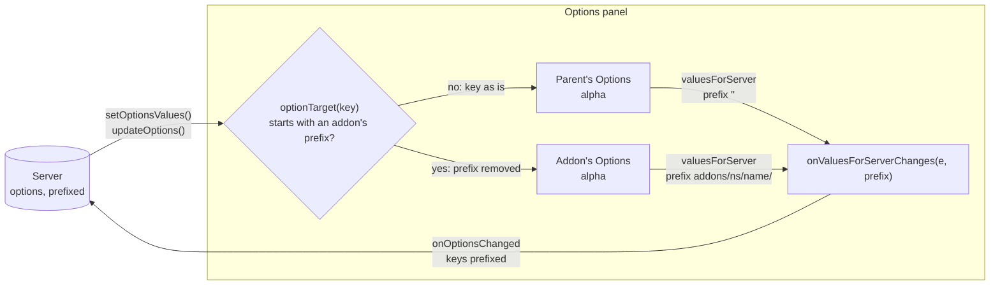
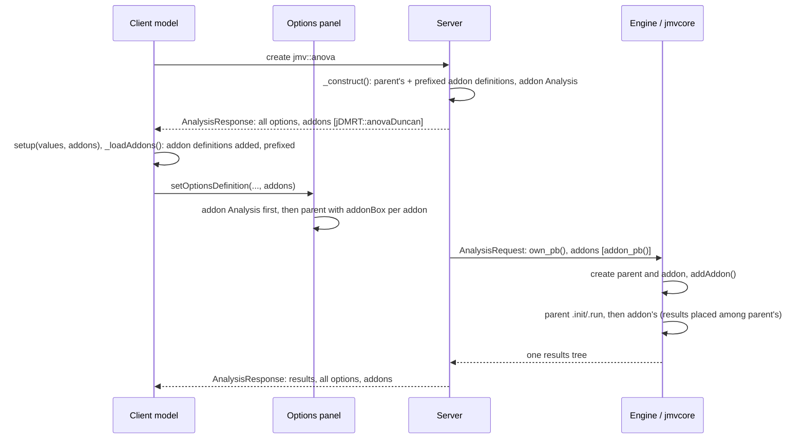
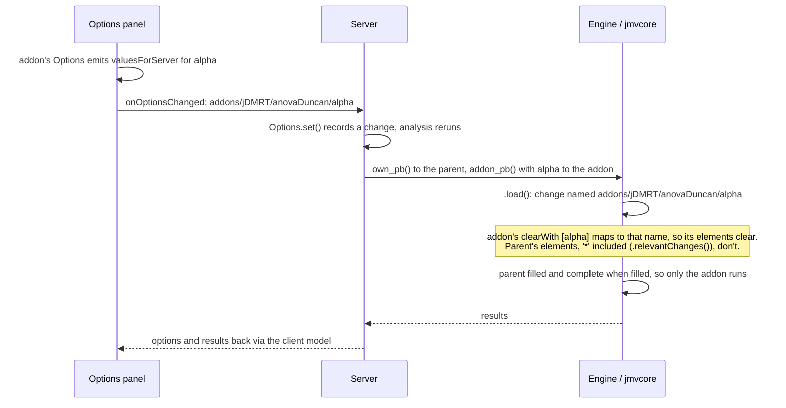
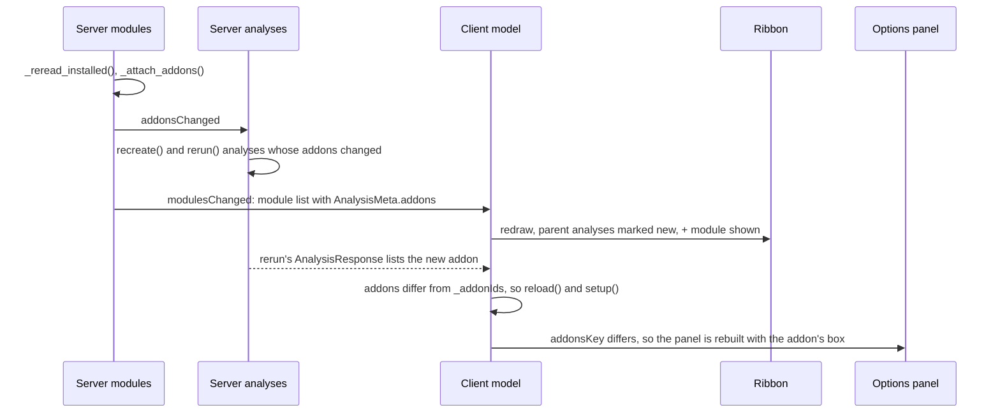

# Addons: implementation

How the addon system works inside jamovi: the protocol, the server, the engine
and jmvcore, and the client. For writing an addon, see [addons.md](addons.md);
this assumes you've read it.

- [Overview](#overview)
- [Names](#names)
- [Protocol](#protocol)
- [Server](#server)
- [Engine](#engine)
- [jmvcore](#jmvcore)
- [Client: model](#client-model)
- [Client: options panel](#client-options-panel)
- [Client: indicators](#client-indicators)
- [Walkthroughs](#walkthroughs)
- [Tests](#tests)
- [Known gaps](#known-gaps)


## Overview

An addon is an analysis whose `0000.yaml` entry has `addonFor: <ns>::<name>`.
It has no menu entry. Whenever its parent is created, the addon is created with
it. The addon has options, a UI and results of its own, and it runs in the same
R process as its parent, straight after it.

The design rests on one decision: **an addon's options travel inside its
parent's options**, under a prefix, as `addons/<ns>/<name>/<option>`. So
nothing that stores, sends, saves, undoes or renames an analysis's options has
to know that addons exist. Only the two ends split them apart:

- the server, before sending options to the engine;
- the options panel, before handing them to the controls.




## Names

| Name | Where | Meaning |
|---|---|---|
| `addons/<ns>/<name>/<option>` | everywhere options are stored or sent | an addon's option, as carried in its parent's options |
| `<option>` | the addon's R code and its UI | the same option, as the addon knows it |
| `parent:<option>` | an addon's `.r.yaml` `clearWith` | one of the parent's options |
| `ui.parent_<option>` | an addon's UI events | one of the parent's options, read only (`parent_<option>_changed` to handle changes) |
| `.ppi`, `theme`, `palette`, `decSymbol`, `.lang` | `options.py` `SETTINGS` | settings an addon is also sent, as its parent is |

An analysis can't define options starting `addons/` or `results/`. The server
refuses to construct it ([analyses.py](../server/jamovi/server/analyses/analyses.py),
`_construct()`).

The helper that builds the prefix exists three times, and the three must agree:
- `addon_prefix()` in `options.py`;
- `Options$.addonPrefix()` in jmvcore;
- `addonPrefix()` in `client/main/analyses.ts` and `client/analysisui/main.ts`.


## Protocol

[jamovi.proto](../server/jamovi/server/jamovi.proto):

```proto
message AnalysisRequest {
    ...
    AnalysisOptions options = 6;
    repeated string changed = 8;
    repeated AnalysisRequest addons = 12;   // (older field, reused)
}

message AnalysisResponse {
    ...
    // the addons active on the analysis. their options are carried in
    // options, named addons/<ns>/<name>/<option>
    repeated AnalysisAddon addons = 22;
}

message AnalysisMeta {          // in ModuleMeta, the module list
    ...
    // the analyses which are addons to this one
    repeated AnalysisAddon addons = 9;
}

message AnalysisAddon {
    string ns = 1;
    string name = 2;
}
```

- **`AnalysisRequest.addons`** goes from the server to the engine: one nested
  request per addon, each carrying that addon's options as it knows them.
- **`AnalysisResponse.addons`** goes from the server to the client. It's how
  the client learns which addons an analysis has. The client never works this
  out itself, so the server is the single source of truth.
- **`AnalysisMeta.addons`** is in the module list. The ribbon uses it before
  any analysis exists.
- **`AnalysisResponse.options`** going to the client always holds the full
  options, prefixed addon options included. Those are what the client edits
  and sends back.


## Server

`server/jamovi/server`

### Attaching addons

[modules/modules.py](../server/jamovi/server/modules/modules.py),
`_attach_addons()`:
- Runs whenever the installed modules are reread: at startup, and after an
  install or uninstall.
- Clears every analysis meta's `addons`, then appends `(ns, name)` to the
  parent named by each `addonFor`.
- Sorts each list by module, which fixes the order addons run in and appear in
  the panel.
- Notifies `addonsChanged`.
- An `addonFor` naming something that isn't installed is skipped silently.

### Constructing an analysis

[analyses/analyses.py](../server/jamovi/server/analyses/analyses.py):
- **`_read_addons(analysis_meta)`** reads each addon's meta, translates its
  defaults, and returns its option definitions renamed with the prefix. An
  addon whose module can't be read is logged and left out; the parent still
  constructs.
- **`_construct()`** appends those definitions to the parent's, and builds one
  `Options` from them all. So addon options are fully typed on the server,
  which is what makes renames and pruning work. It also constructs each addon
  as an `Analysis` (same id) and passes them as `addons=`.
- **`_module_event()`**, on `addonsChanged`, finds the open analyses whose
  addon list no longer matches their meta's, then recreates and reruns them.
  `recreate()` keeps the options, so values survive.

### Options

[options.py](../server/jamovi/server/options.py):
- **`own_pb()`**: the options without any `addons/` ones. This is what the
  parent analysis is sent.
- **`addon_pb(ns, name)`**: one addon's options, renamed without the prefix,
  plus the `SETTINGS`. Each typed option is pruned against the variables the
  parent uses (`get_using(include_addons=False)`), using `prune_using()` on
  `OptionVariable`, `OptionVariables`, `OptionTerms`, `OptionPairs` and
  `OptionArray`. A term goes if any of its variables isn't allowed. **Pruning
  only touches the copy that's sent**, so if the parent takes a variable up
  again, the addon's selection comes back. This enforces "an addon may only
  use its parent's variables".
- **`get_using(include_addons=True)`**: by default includes addon options, so
  a column used only by an addon still counts as in use.
- **`rename_using()`**: covers addon options like any other, because they're
  typed.
- **`set(pb)`** changes nothing for addons: a prefixed option is an option. An
  incoming name with no definition (an addon whose module has gone) is kept in
  the protobuf untyped. It's saved and round-tripped, but not renamed or
  pruned. If the module comes back, it's typed again.

### Scheduling

[scheduler.py](../server/jamovi/server/scheduler.py), `_to_message()`:

```python
for addon in analysis.addons:
    addon_pb = request_pb.addons.add()
    self._to_message(addon, perform, addon_pb)
    addon_pb.options.CopyFrom(analysis.options.addon_pb(addon.ns, addon.name))
    addon_pb.changed.extend(analysis.changes)
...
request_pb.options.CopyFrom(analysis.options.own_pb())
```

`changed` is the parent's change set, named as carried (prefixed). There is no
separate scheduling for addons: changing an addon option is a change to the
parent's options, so the parent reruns, and its addons run with it.

### Responses

[analyses/analysis.py](../server/jamovi/server/analyses/analysis.py),
`set_results()`:
- The engine's results carry only the parent's own options, so the server
  always copies the full options (addons' included) back into the response.
- `write_addons_pb()` fills `AnalysisResponse.addons`.

[instance.py](../server/jamovi/server/instance.py):
- The response to a create goes through `write_addons_pb()` too.
- The module list fills `AnalysisMeta.addons` from each meta's `addons`.


## Engine

[engine/engine/enginer.cpp](../engine/engine/enginer.cpp), `create()`:
- Creates the parent with `jmvcore::create()`, then recursively creates each
  nested `AnalysisRequest` in `addons` and calls the parent's `addAddon()`.
  This predates this work and is unchanged.
- The engine gives the dataset readers, the state path, the resources path and
  the checkpoint **to the parent only**. jmvcore passes on what addons need
  (see below).


## jmvcore

`jmvcore/R`

### Becoming an addon

[analysis.R](../jmvcore/R/analysis.R), `addAddon(addon)`:
- Records the addon, and sets its parent, so `self$parent` works in addon code.
- Calls `addon$options$.setParentOptions(self$options)`, which makes the
  addon's options aware they're an addon's.
- Calls `.shareSources(addon)`, which hands the addon the parent's dataset
  readers and resources path. `.setReadDatasetSource()` and
  `.setResourcesPathSource()` also forward to addons added earlier, so the
  order the engine calls them in doesn't matter.

### Option names

[options.R](../jmvcore/R/options.R). An addon's `Options` knows its parent's
`Options` and maps between the two naming schemes:
- **`.addonPrefix()`**: `addons/<package>/<name>/`.
- **`.rootNames(names)`**: maps names as the addon knows them to names as
  carried. `x` becomes `addons/<ns>/<name>/x`, and `parent:x` becomes `x`. For
  a non-addon, names map to themselves.
- **`.rootOption(rootName)`**: the option behind a carried name, the addon's
  own or the parent's.
- **`.relevantChanges(rootNames)`**: the changes an element's results can
  depend on. For a parent that excludes all `addons/` changes. For an addon it
  excludes other addons' changes. This is what keeps `clearWith: '*'` from
  clearing the parent's results when only an addon's option changed.
- **`.rootProtoBuf()` / `.fromRootProtoBuf(rootPB)`**: convert an addon's
  options to and from the carried form, used for the saved state.

### Results and `clearWith`

[results.R](../jmvcore/R/results.R): every element compares changes through
three private helpers:
- `.clearsWith()`: its `clearWith`, mapped with `.rootNames()`;
- `.clearWithOption(name)`;
- `.someChanges(oChanges, vChanges)`, for `'*'`.

`array.R`, `group.R`, `html.R`, `image.R`, `output.R`, `preformatted.R`,
`table.R` and `text.R` use them where they used to read `private$.clearWith`
directly.

An addon's results are its own `Group`, created with its own options. The
addon moves elements into the parent's results in `.init()`
(`self$parent$results$add(...)`). An element remembers the options it was made
with, so it keeps following the addon's options wherever it's placed.

**Images.** An image moved into the parent's results takes the parent as its
`$analysis`. So `Image` renders through `private$.renderer()`, which is
`self$options$analysis`: the analysis whose options the image was made with,
meaning the addon. Resizing an image in the results sets
`results/<path>/widthScale` and `heightScale` among the parent's options (the
server sends `results/` options to the parent only). `Image$size` looks these
up with `self$options$.rootOption()`, which finds them in the parent's options
for an addon's image.

### State and selective running

[analysis.R](../jmvcore/R/analysis.R):
- **`.stateOptions()`**: the options saved in the state file. It holds the
  parent's own options plus each addon's in carried form, so a later load can
  tell what changed for each.
- **`.load()`**: computes the parent's changes from the state, then each
  addon's (`.fromRootProtoBuf()` → `compProtoBuf()` → `.rootNames()`), and
  restores the results with all of them.
- **`isFilledFor(element, options)`**: whether the elements made with
  `options` are filled. `.load()` uses it to set a private `.needsRun` on the
  parent and on each addon, honouring each one's own `completeWhenFilled`.
  The analysis is marked complete only if none of them needs to run.

### Running

`init()` interleaves each step for the parent then each addon:
1. `check(checkValues)`
2. `results$.update()`
3. `check(checkVars)`
4. `.init()`
5. `check(checkData)`

`run()` runs the parent's `.run()` if it needs to, then each addon's, with a
`.checkpoint()` between them. Addons get the parent's data, so they don't read
the dataset again.

### Errors

- **`.tryAddon(addon, fn)`** wraps every addon step. An error marks the addon
  errored, and from then on its steps are skipped. A `restarting` status
  (checkpoint) is re-raised, not swallowed.
- **`.addonError(addon, message)`** shows the error on the addon's placed
  results. If none are placed, it adds a `Preformatted` named
  `.addon-<package>-<name>` to the parent's results, just to show the error.
- **The parent is never marked errored by an addon.**

### From R

- **Compiler** ([header.template](../jamovi-compiler/header.template)): for an
  analysis with `addonFor` (and `export` not false), the generated function
  takes `parent` first, and has no `data`. It decomposes `Terms` formulas,
  builds the options, creates the addon's class without data, and ends with
  `jmvcore::runAddon(parent, analysis, "<addonFor>")`.
- **`runAddon(parent, addon, addonFor)`**
  ([analysis.R](../jmvcore/R/analysis.R), exported):
  - checks `parent` is the results of an analysis named `addonFor`
    (`parent$analysis`);
  - calls `Analysis$.runAddon(addon)`;
  - returns `parent`.
- **`Analysis$.runAddon(addon)`**: runs once the parent has run. It:
  - calls `addAddon()`;
  - lends the addon the parent's data (kept, since it was passed in);
  - runs the addon's checks, `results$.update()`, `.init()` and `.run()`,
    all inside `.tryAddon()`.
- **Reaching added results:** `$.ResultsElement` ([results.R](../jmvcore/R/results.R))
  falls back to a group's `items`, so items added to the parent's results are
  reached as `results$name`, as its own are.
- **Syntax:** the syntax element is
  `paste0(self$asSource(), private$.addonsAsSource())`. It's built outside
  `asSource()` because analyses override that (jmv's ANOVA does).
  - `.addonsAsSource()` adds ` |>
    ns::name(args)` for each addon whose
    function is exported (`addonExported()`) and that has options away from
    their defaults (`.asArgs(incData=FALSE)` is non-empty).
  - The addon's function is named after the analysis; `rename` isn't
    supported for addons.

### References

`.refsLookup()` merges the `.jmvrefs` of the parent's package and its addons'
packages, the parent's taking precedence, so an addon's `refs:` resolve.
`packageRefs()` reads one package's.


## Client: model

`client/main`

- **[modules.ts](../client/main/modules.ts)**: `IAnalysisMeta.addons` comes
  from `AnalysisMeta.addons`. A change in an analysis's addons counts as a
  module change, so the ribbon redraws.
- **[analyses.ts](../client/main/analyses.ts)**, `Analysis`:
  - **`setup(values, addons)`**: receives the addon ids from the response.
  - **`_loadAddons()`**: runs during `reload()`, after the parent's definition
    is loaded and before values are applied. For each addon it fetches the
    definition and translations from the addon's module. It adds the
    definitions to the parent's `Options`, prefixed, via
    `Options.addDefinitions()`. Then it builds an `AnalysisAddon`: ns, name,
    title (the addon's menu title), the module's title, the UI JS and i18n. An
    addon that fails to load is left out.
- **[instance.ts](../client/main/instance.ts)**:
  - `_addonIds(response)` reads `AnalysisResponse.addons`.
  - When a response for an open, ready analysis lists different addons, the
    analysis is reloaded, so installing or removing an addon module updates
    open analyses.
- **[optionspanel.ts](../client/main/optionspanel.ts)**: passes
  `analysis.addons` with `setOptionsDefinition`. A cached panel remembers the
  `addonsKey()` it was built with, and is rebuilt if the analysis's addons
  have since changed.


## Client: options panel

`client/analysisui` (runs in the options iframe)

### One `Analysis` per addon

[main.ts](../client/analysisui/main.ts):
- **`loadAnalysis()`**: receives the `AddonDef`s. It constructs each addon
  first, with `new Analysis(uijs, i18n, …, addonDef)`, then the parent with
  the addons.
  - **Why addons come first:** each `Analysis` sets the global `_()`/`n_` to
    its own translations, and the parent must be left as the global one.
  - **Isolation:** each addon has its own `Options`, `View`,
    `LayoutActionManager` and `I18n` (`module: <id> <prefix>`). The addon's
    controls and events see its options by their unprefixed names.
- **Layout checks.** An addon's layout is checked by `checkAddonLayout()`: a
  `VariableSupplier` must be `populate: manual`. That, with server pruning,
  keeps addons to the parent's variables.
- **Placement.**
  - The parent's constructor appends an `addonBox(addon)` for each addon that
    has controls (`hasControls`) to its own layout. This is an `AddonBox`
    holding an `AddonHost` ([addonhost.ts](../client/analysisui/addonhost.ts)),
    a plain grid control that hands itself to the addon (`onCreated`).
  - So the addon's options live inside the parent's layout and its single
    scroll area.
  - An addon without controls gets no box. It's still constructed and
    rendered, detached, because `isLoaded()` waits on every view.
- **Rendering.** After the parent renders, `addon.renderIn(parent)` does two
  things:
  - `attachParent()` registers a `ParentOptionResource` per parent option as
    `parent_<name>` in the addon's action manager. This is what
    `ui.parent_<name>` and `parent_<name>_changed` are. The resource forwards
    `value()`, `getTrigger()`, `on()` and `off()` to the parent's resource,
    and has no setter.
  - It then appends the addon's view to its host and renders it.

### Routing values

- **From the server to the controls.** `setOptionsValues()` (whole sets) and
  `updateOptions()` (changes) send each key through
  `analysis.optionTarget(key)`. A key starting with an addon's `prefix` goes to
  that addon's `Options` under the bare name. Everything else goes to the
  parent.
  - **Order:** in `setOptionsValues()`, the parent's
    `endDataInitialization()` runs before the addons', so addons see the
    parent's final values.
  - **Edit scope:** both run inside `runInEditScope()`, which opens and closes
    an edit on every `Options` together.
- **From the controls to the server.** Each `Options` (the parent's and every
  addon's) has an `options.valuesForServer` listener, `onValuesForServerChanges(e,
  prefix)`. It re-adds the addon's prefix before sending `onOptionsChanged` to
  the main window. From there on it's an ordinary option change.



### Header

The box is an `AddonBox` ([addonbox.ts](../client/analysisui/addonbox.ts),
styled in `addonbox.css`). It's a subclass of the collapse box
(`LayoutCollapseView`). It's jamovi's own, not one of the `DefaultControls`,
so a module's `.u.yaml` can't use it, and the `CollapseBox` modules use has no
addon code in it. It takes two extra properties:
- `addon`: the module's short name;
- `addonTitle`: the module's title.

The header shows the addon's title, then a separator, the module icon and the
short name (`.jmv-addon-module`). It has the addon colours and a tooltip
"Added by the {module} module".


## Client: indicators

- **Options panel title.** `addAddonsTag()` adds an "Addons" tag (tick and
  chevron) under the title, or beside the analysis's name when the title has
  been edited (`placeAddonsTag()`, called from `setTitle()`). It opens a list
  of the addons. Choosing one expands its box (by clicking its header) and
  scrolls to it. Addons without options are listed but disabled.
- **Ribbon** ([analysetab.ts](../client/main/ribbon/analysetab.ts),
  [ribbonmenu.ts](../client/main/ribbon/ribbonmenu.ts)):
  - An analysis counts as new when its module is new, or when any of its
    addons' modules is new ("new" means installed this session, see
    `modules.py`).
  - The menu item then shows `+ <module>` for the new addon modules, hidden
    once the item is no longer marked new.
  - A group button pulses if any of its items is new.

Colours (addon orange, matched to the grey boxes' contrast):

| | Border | Background | Hover | Dark (text, separators) |
|---|---|---|---|---|
| Grey boxes | `#B0B0B0` | `#D8D8D8` | `#C9C9C9` | |
| Addon | `#E7B978` | `#F3DDBE` | `#F0D2A8` | `#A67B3F`, `#85602A` |


## Walkthroughs

### Creating an analysis that has an addon



### Changing an addon option



### Installing an addon module while an analysis is open



### Opening a file whose addon module isn't installed

- **On load:** the addon's options are in the file under the prefix. With no
  definitions, the server keeps them untyped in the protobuf.
- **What you see:** the parent runs normally, without the addon.
- **What's kept:** the values are saved again unchanged.
- **If the module is installed later:** the options are typed again and the
  addon picks them up. Column renames made in the meantime won't have reached
  them.


## Tests

- **Server:**
  - [server/jamovi/tests/test_options.py](../server/jamovi/tests/test_options.py)
    covers `own_pb`, `addon_pb`, settings, pruning, `get_using`, renames and
    `set`.
  - [test_analyses.py](../server/jamovi/tests/test_analyses.py) covers
    construction and reserved names.
- **jmvcore:**
  [jmvcore/tests/testthat/test-addons.R](../jmvcore/tests/testthat/test-addons.R)
  covers:
  - name mapping and round trips;
  - `clearWith` for the addon's options, the parent's options and `'*'`;
  - state and `.load()` changes;
  - references;
  - error isolation;
  - selective running;
  - addon images (rendering and size);
  - running from R (`runAddon()`), and the chained syntax.
- **Client:** no automated tests. The changes were checked by comparing
  `tsc --noEmit` error counts before and after (the client has many existing
  errors).


## Known gaps

- **Translations in events:** `_()` in an addon's events, while the panel is
  in use, uses the parent's translations (the global is the parent's).
  Translations in the addon's `.u.yaml` are fine.
- **`minApp`:** the jamovi version that addon options need hasn't been
  decided, so modules can't yet declare it.
- **Turning an addon off:** an addon can't be switched off per analysis. The
  options transport could carry a flag (`addons/<ns>/<name>/.enabled`) if
  this is wanted.
- **New strings:** the new client strings ("Addons", "With addons from
  {modules}", "Added by the {module} module", "This addon has no options")
  aren't in the translation catalogues yet.
